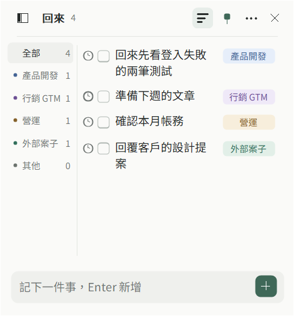

# 回來 · Return Note

一張放在 Windows 桌面角落的繁中待辦便條。切走前，留一句「回來先做什麼」。

比如等一輪測試時，你得先去回客戶。按 `Ctrl+Alt+N` 記下「回來先看登入失敗的兩筆」，按 Enter 就能繼續手上的事。回到桌面時，下一步就在那裡。

**[下載 Windows x64 版](https://github.com/wsxqaza12/return-note/releases/latest/download/return-note-windows-x64.zip)** · [發行紀錄](https://github.com/wsxqaza12/return-note/releases) · [回報問題](https://github.com/wsxqaza12/return-note/issues)



## 開始使用

1. 下載 ZIP，完整解壓縮，雙擊 `return-note.exe`。這是 Rust 製作的 Windows 原生程式，可直接執行。發行檔尚未簽署，Windows 首次啟動時可能顯示提示。
2. 在底下打一句待辦，按 **Enter** 加入。**Shift+Enter** 換行，雙擊便條可編輯標題及「回來先做什麼」。
3. 把視窗拖到桌面角落。點圖釘可置頂，在 **⋯ → 字體與便條大小** 可選 70% 到 125%。左上角可收起分類側欄。

## 在便條上就能做的事

| 想做什麼 | 怎麼操作 |
| --- | --- |
| 整理待辦 | 新便條會自動分類。點彩色標籤可換分類，拖文字可排序。圖釘左邊的三條橫線可依標籤整理目前清單，同類內保留原順序。 |
| 記錄花費時間 | 點某一列的小時鐘開始，再點可暫停。勾選完成會停表，到「⋯ → 已完成的便條」查看累計用時。 |
| 等結果時先切走 | 右鍵選「等結果」，可加 10 分鐘回看提醒。提醒在程式執行期間生效。 |
| 找回之前的事 | 按 **Ctrl+F** 搜尋。視窗收到工作列後，用 **Ctrl+Alt+N** 叫回來。 |

## 本機資料與選用的 AI

預設可離線使用，程式依關鍵字分成產品開發、行銷 GTM、營運、外部案子與其他。想讓 Gemini 整理短標題及分類，可在「設定」填入自己的 Google Gemini API key，儲存後按「測試連線」。開啟後，新便條的原文會送到 Google。金鑰存於 Windows 認證管理員。

便條、排序、累計用時和草稿存於 `%LOCALAPPDATA%\ReturnNote\notes.json`。設定中的「匯出便條」可備份資料。要更新版本，先從選單結束程式，再換成新版執行檔。

## 從原始碼建置

使用 Rust stable（edition 2024）。在 Linux／WSL 安裝 Rust 的 Windows x64 GNU LLVM target，並將 llvm-mingw 的 `bin` 加到 PATH。建置會用到其中的 clang 與 windres。

```sh
rustup target add x86_64-pc-windows-gnullvm
cargo test --locked
CARGO_TARGET_X86_64_PC_WINDOWS_GNULLVM_LINKER=x86_64-w64-mingw32-clang \
  cargo build --locked --release --target x86_64-pc-windows-gnullvm
```

執行檔位於 `target/x86_64-pc-windows-gnullvm/release/return-note.exe`。Windows 操作測試見 [驗證腳本](scripts/verify-windows.ps1)。

## 為什麼留一句下一步

工作中斷時，先記下做到哪、之後從哪裡接手，有助於減少切換後仍惦記上一件事的注意力殘留。「回來先做什麼」這個欄位來自這個想法。[華盛頓大學研究說明](https://www.washington.edu/news/2018/01/16/task-interrupted-a-plan-for-returning-helps-you-move-on/)
